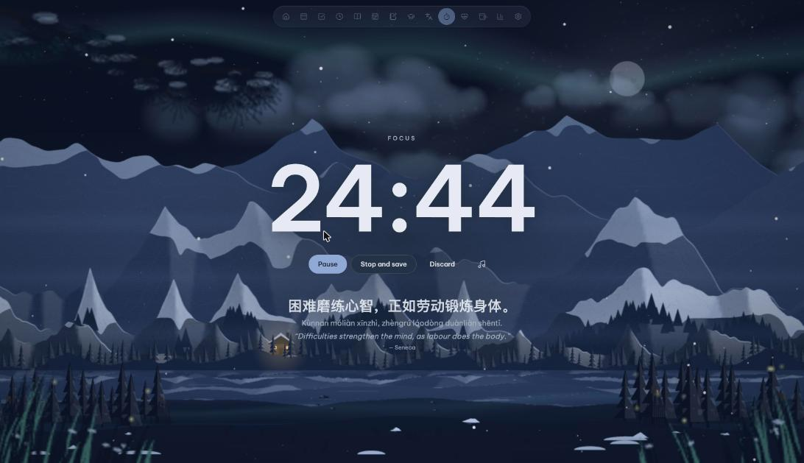
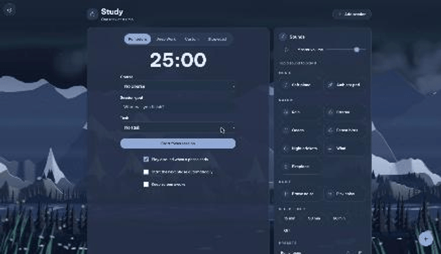
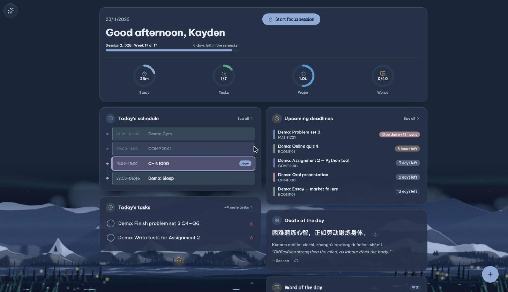
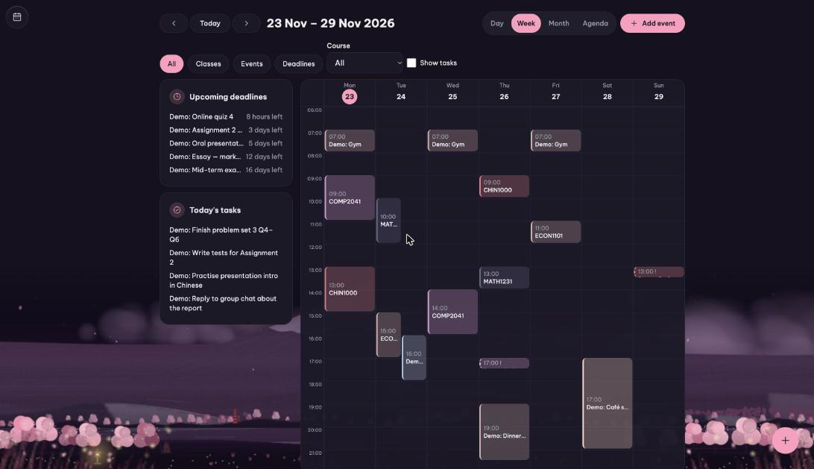
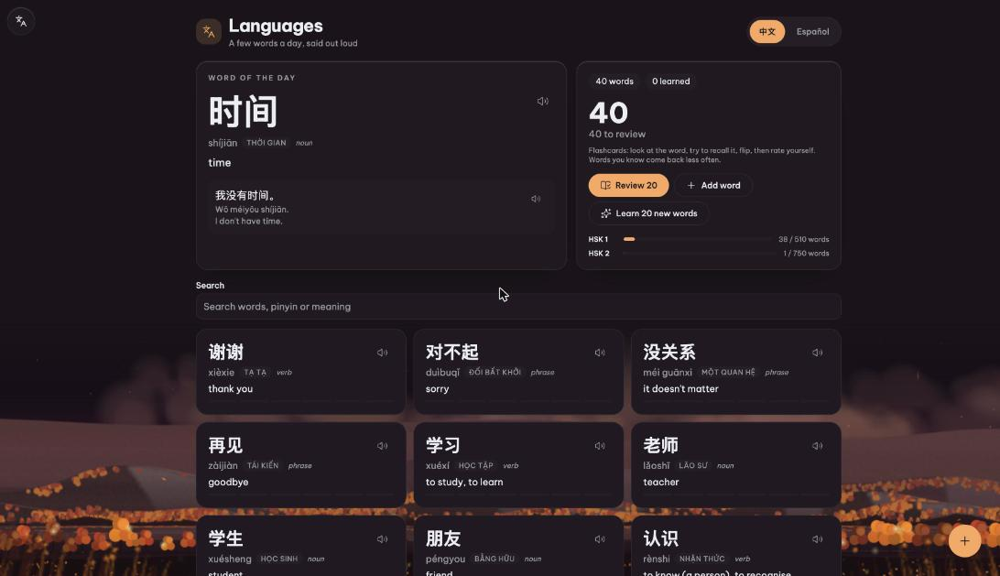
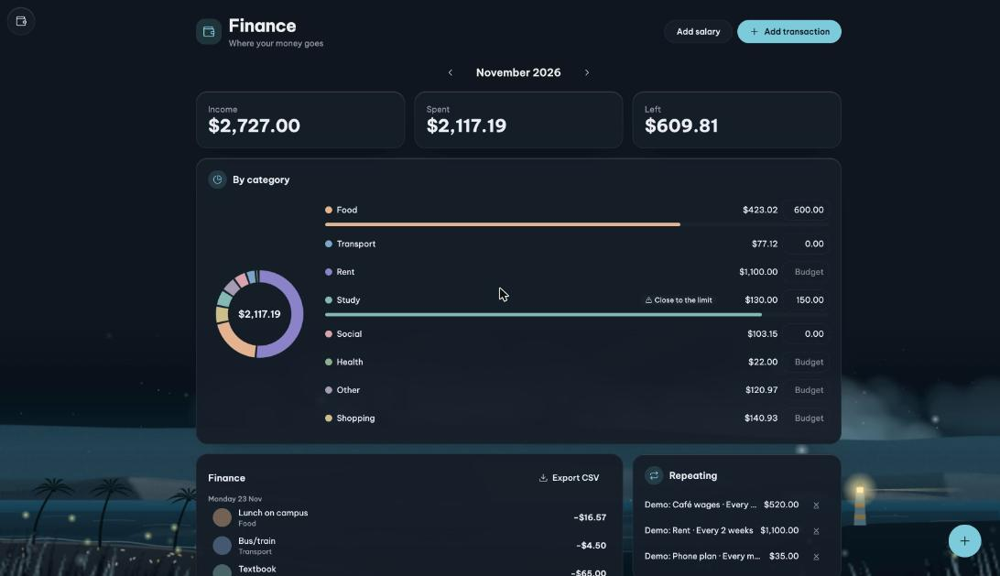
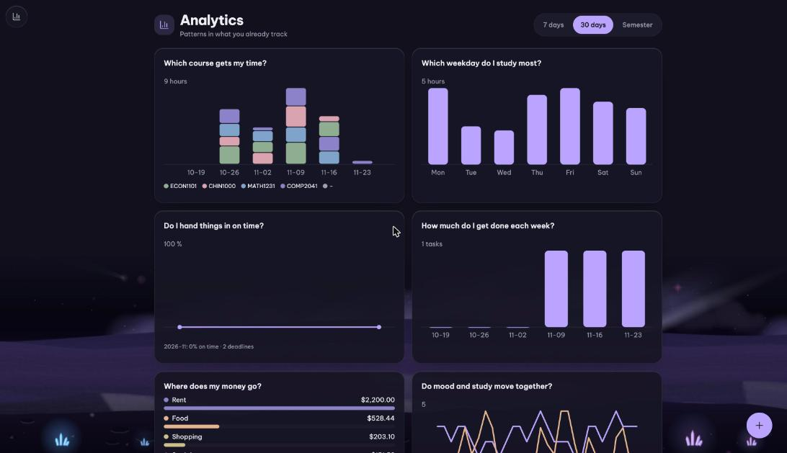
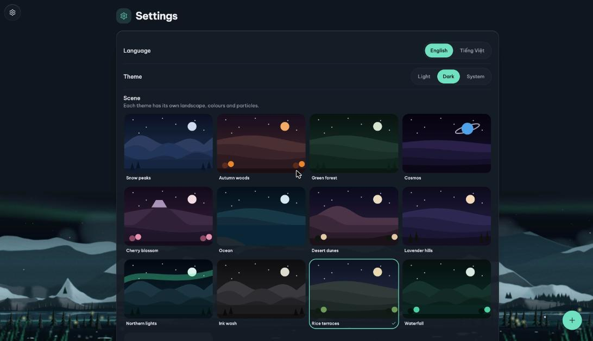

<p align="center">
  
</p>

<h1 align="center">Nook</h1>
<p align="center"><b>Your own quiet corner for uni life.</b><br/>
Timetable, deadlines, tasks, focus timer, grades, notes, well-being, money and languages, in one calm app set in a living landscape.</p>
<p align="center"><a href="https://uniflow-mu.vercel.app">uniflow-mu.vercel.app</a> · made by <b>Kayden Hoang</b></p>

<p align="center"></p>

## Demo

<p align="center"></p>

| | |
|---|---|
|  **Home** — today at a glance |  **Planner** — colours follow the theme |
|  **Languages** — HSK 1–2 and Spanish A1–A2 |  **Finance** — budgets and recurring money |
|  **Analytics** — study, deadlines, money, mood |  **Twelve scenes**, light and dark |

---

## Contents
- [Demo](#demo)
- [Features](#features)
- [Scenes](#scenes)
- [Tech stack](#tech-stack)
- [Run it locally](#run-it-locally)
- [Set up your own copy](#set-up-your-own-copy)
- [Project structure](#project-structure)
- [How it works](#how-it-works)
- [Testing](#testing)
- [Performance](#performance)
- [Privacy and security](#privacy-and-security)
- [Credits](#credits)

## Features

| Area | What you get |
|---|---|
| **Home** | Greeting, semester progress, live weather, four progress rings (study minutes, tasks, water, words), today's timeline, top tasks, upcoming deadlines, quote and word of the day |
| **Planner** | Day / week / month / agenda views; classes from your timetable, personal events with repeats (daily, weekly on chosen days), deadlines and tasks; colours follow the current theme |
| **Tasks** | Today / upcoming / overdue / completed tabs, quick add, subtasks, up to 3 pinned "top" tasks, filters, animated tick with undo |
| **Deadlines** | Every assessment type, weight, progress, countdown chips that turn urgent, linked tasks |
| **Courses & semesters** | Timetable per course (lecture, tutorial, practical…), semester weeks and breaks, course detail page |
| **Study room** | Pomodoro, deep work, custom and stopwatch timers (timestamp-based, survive reloads and other devices); **focus mode** morphs the clock to full screen over the landscape; a generative sound mixer (piano, pad, rain, stream, ocean, fireplace, forest, wind, night, noise) with presets and a sleep timer |
| **Grades** | Weighted assessments, hurdles, "what do I need on the final", WAM/GPA from finished courses |
| **Notes** | Markdown with live preview, clickable checklists, pinned notes, autosave with offline drafts |
| **Well-being** | Daily check-in (mood, energy, sleep, water, a note), habits with streaks, 30-day view |
| **Finance** | Income and expenses, categories (incl. Shopping), monthly budgets, recurring salary/rent/bills, donut breakdown, CSV export |
| **Analytics** | Study time per course and weekday, on-time rate, tasks per week, spending, mood vs. study |
| **Languages** | Flashcards with spaced repetition (Leitner), a practice mode, pronunciation, the complete **HSK 3.0 bands 1–2 (1,256 words)** with pinyin, Hán Việt, English and Vietnamese, and **775 Spanish A1–A2 words**; unlocked 20 at a time with per-level progress |
| **Settings** | Language (English / Vietnamese), light / dark / system, 12 scenes, menu as sidebar or floating bubble, performance (auto / best / balanced / light), reduce effects, weather location, dashboard widgets, rich demo data, JSON export, delete all |
| **App** | Installable PWA (home-screen icon, works offline for the shell), safe-area aware on iPhone, landscape and iPad layouts |

## Scenes

Twelve hand-coded, animated landscapes, each with its own light and dark palette that also re-colours the whole interface:

Snow peaks · Autumn woods · Green forest · Cosmos · Cherry blossom · Ocean · Desert dunes · Lavender hills · Northern lights · Ink wash · Rice terraces · Waterfall

Each scene is painted on a `<canvas>` from layered noise: five mountain ranges with lit and shadowed faces, snow lines and rim light, haze, a lake or sea with reflections and a shimmering sun path, trees that sway, scene props (cabin with chimney smoke, pagoda and torii, lighthouse with a sweeping beam, pyramids and a camel caravan, a waterfall, rice terraces), drifting particles (snow, leaves, petals, star dust, sand), a real moon phase, and **live weather** (rain with ripples, snow, fog, storms with lightning).

## Tech stack

- **Frontend:** React 19, TypeScript (strict), Vite, Tailwind CSS v4, React Router 7, TanStack Query, Radix UI, Lucide icons, i18next, Luxon, Zod
- **Backend:** Supabase (Postgres, Row Level Security, Auth)
- **Hosting:** Vercel; PWA via `vite-plugin-pwa`
- **Data sources:** Open-Meteo (weather, no key needed); HSK word list from [complete-hsk-vocabulary](https://github.com/drkameleon/complete-hsk-vocabulary)
- **Tests:** Vitest + Testing Library (280+ tests)

## Run it locally

```bash
npm install
cp .env.example .env      # then fill in your Supabase URL and anon/publishable key
npm run dev               # http://localhost:5173
```

Other scripts:

| Command | What it does |
|---|---|
| `npm test -- --run` | Run all tests once |
| `npm run build` | Type-check and build for production into `dist/` |
| `npm run gen:scenes` | Regenerate `src/styles/scenes.css` from the scene definitions |
| `node scripts/make-icons.mjs` | Regenerate the PNG app icons from `public/brand/*.svg` |

## Set up your own copy

1. **Supabase** — create a project, then run the SQL files in `supabase/migrations/` **in order** in the SQL Editor:
   `0001_init` → `0002_grants` → `0003_phase2` → `0004_vocab` → `0005_scenes` → `0006_any_scene`.
   (`*_down.sql` files undo a migration.) Details: [`docs/SETUP-SUPABASE.md`](docs/SETUP-SUPABASE.md).
2. **Environment** — put `VITE_SUPABASE_URL` and `VITE_SUPABASE_ANON_KEY` in `.env` (local) and in your Vercel project's environment variables. Only the public anon/publishable key belongs here; **never** the service-role key.
3. **Deploy** — [`docs/DEPLOY-VERCEL.md`](docs/DEPLOY-VERCEL.md). Add your site URL to Supabase → Authentication → URL configuration.
4. **Backups** — [`docs/BACKUP-RESTORE.md`](docs/BACKUP-RESTORE.md).

Every account only ever sees its own rows (RLS on every table), so friends can sign up on the same deployment.

## Project structure

```
src/
  app/            layout, router, sidebar, floating menu, form host, error boundary
  components/     shared UI: Button, Card, CheckButton, Ring, Sheet, Toast, Background, Logo…
  features/       one folder per page (dashboard, calendar, tasks, deadlines, courses, study,
                  grades, notes, wellbeing, finance, analytics, languages, settings, auth)
  lib/            pure logic with tests: time, recurrence, timer, grades, finance, srs, stats,
                  weather, quotes, markdown, perf, daily rotation, data hooks
    scene/        the landscape engine (landscape.ts), scene palettes (scenes.ts),
                  props and framing (details.ts, framing.ts), noise
    sound/        DSP, rendered nature loops and the generative piano/pad
  locales/        en.json, vi.json (kept in sync by a test)
  styles/         design tokens, generated scene palettes, motion system
public/
  brand/          logo and app icons (SVG)
  vocab/          HSK 1–2 and Spanish A1–A2 word banks (JSON, loaded on demand)
supabase/migrations/   schema, policies and functions
docs/             setup, deploy, backup, sounds, acceptance checklist
```

## How it works

- **Data:** every table has `user_id`, soft delete (`deleted_at`) and an `is_demo` flag. Reads go through small `useRows`/`useTable` hooks on top of TanStack Query; deletes are soft with an Undo toast. Demo data is fully removable without touching real rows.
- **Timer:** stored as timestamps (`resumed_at`, `accumulated_seconds`), so the clock is right after a reload or on another device; starting and stopping are optimistic for instant feedback.
- **Spaced repetition:** Leitner boxes with intervals 0, 1, 3, 7, 14, 30, 60 days.
- **Daily rotation:** the quote and word of the day change every day and walk the whole list before repeating.
- **Themes:** `scenes.ts` defines each scene's art palette and accent; a generator derives readable UI colours (checked for WCAG contrast by tests) and a matching 8-colour planner palette.
- **Motion:** one set of easing curves; route changes and the study clock use the View Transitions API (with fallbacks).

## Testing

```bash
npm test -- --run
```

Covers the pure logic (time zones and DST, recurrence, timer, grades, finance, SRS, analytics, markdown, colour parsing, daily rotation, word banks), contrast of every theme, i18n key parity, and a smoke test that renders every page.

## Performance

The landscape is the heaviest part, so it is built to be cheap:
static layers are pre-rendered once (and rebuilt in small chunks when you change theme, behind a cross-fade), the canvas draws at reduced resolution, glows are cached sprites, and the scene pauses while you scroll, review flashcards or while the tab is hidden. An **Auto** performance mode measures real frame times and lightens the scene on slower devices; Settings → Performance lets you choose.

## Privacy and security

- Row Level Security on every table; the frontend only holds the public anon key.
- Weather requests send only the chosen city's coordinates.
- No analytics, no third-party trackers.

## Credits

Designed and built by **Kayden Hoang**. Logo: the *nook* — an arch in the wall with a dot inside: your own corner.

© 2026 Kayden Hoang. All rights reserved.
